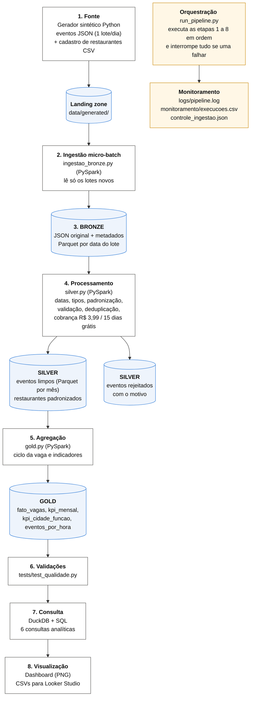

# UmFreela Data Lakehouse

Pipeline completo de Big Data que coleta, armazena, processa e disponibiliza os eventos da **UmFreela**, plataforma que conecta restaurantes a freelancers de todas as funções do setor (garçom, cozinheiro, bartender e outras).

Trabalho da disciplina *Introdução ao Big Data, Armazenamento e Processamento de Dados em Escala, Tecnologias para Ciência de Dados e Bancos de Dados NoSQL* (Prof. Felipe Becker Nunes), Especialização em Ciência de Dados e Inteligência Artificial, AMF.

**Aluno:** Jonathan Gonçalves Possa

> Os dados são **sintéticos**: foram gerados por um simulador que segue as regras de negócio da UmFreela, para não expor dados pessoais de usuários reais (LGPD).

---

## 1. Descrição do projeto

Na UmFreela, o restaurante publica uma vaga para um turno, freelancers se candidatam, o restaurante contrata, o turno acontece e, no fim, há avaliação e pagamento. Cada ação gera um evento. O pipeline transforma esses eventos em respostas para o negócio:

- Qual percentual das vagas é preenchido?
- Quanto tempo o restaurante espera até contratar?
- Em quais funções e cidades faltam freelancers?
- Quanto a plataforma fatura por mês (R$ 3,99 por vaga publicada, com os 15 primeiros dias após o cadastro gratuitos)?
- Qual a taxa de cancelamento, de faltas (no-show) e a nota média dos turnos?

A definição completa do problema está em [`docs/01_definicao_do_problema.md`](docs/01_definicao_do_problema.md).

## 2. Arquitetura

Baseada na **Opção B do enunciado** (ambiente local com processamento batch), em arquitetura **Medallion** (Bronze, Silver, Gold). Roda em qualquer máquina com Python e Java, ou no **Google Colab** sem instalar nada.



| Etapa | Ferramenta | O que faz |
|---|---|---|
| Fonte | Python (`ingestion/gerador_eventos.py`) | Gera um lote de eventos por dia (JSON Lines) e o cadastro de restaurantes (CSV), com problemas de qualidade inseridos de propósito |
| Ingestão | PySpark (`ingestion/ingestao_bronze.py`) | Micro-batch: lê **apenas os lotes novos** da landing zone, controlados por `controle_ingestao.json` |
| Bronze | Parquet particionado por `data_lote` | Evento exatamente como chegou (texto JSON original) + arquivo de origem e horário da ingestão |
| Silver | PySpark (`processing/silver.py`), Parquet particionado por `mes` | Datas em 3 formatos padronizadas, cidades e funções padronizadas, tipos convertidos, regras de negócio validadas, duplicados removidos, cruzamento com o cadastro de restaurantes para calcular a cobrança. Registros inválidos vão para `eventos_rejeitados` com o motivo |
| Gold | PySpark (`processing/gold.py`) | `fato_vagas` (uma linha por vaga), `kpi_mensal`, `kpi_cidade_funcao`, `eventos_por_hora` |
| Validação | DuckDB + pytest (`tests/test_qualidade.py`) | 10 verificações de qualidade; o pipeline para se alguma falhar |
| Consulta | DuckDB + SQL (`queries/consultas.sql`) | 6 consultas analíticas, resultados em CSV |
| Visualização | Matplotlib (`dashboard/gerar_dashboard.py`) | Painel PNG + CSVs prontos para o Looker Studio |
| Orquestração | Python (`orchestration/run_pipeline.py`) | Executa as etapas em sequência; uma etapa só começa se a anterior terminou com sucesso |
| Monitoramento | `logs/pipeline.log`, `lake/monitoramento/execucoes.csv` | Log de cada etapa, duração, status e contagens de cada execução |

## 3. Tecnologias utilizadas

Python 3.10+, Apache Spark (PySpark), Parquet, DuckDB, Pandas, Matplotlib, pytest, Google Colab (opcional) e Looker Studio (opcional).

## 4. Pré-requisitos

- **Opção A, Google Colab (recomendada):** só uma conta Google. O Colab já tem Python e Java.
- **Opção B, computador local:** Python 3.10 ou superior e Java 8, 11 ou 17 (exigido pelo Spark). Cerca de 1 GB livre em disco.

Este projeto não cria nenhum recurso em nuvem e não usa Docker; por isso não há `docker-compose.yml` nem scripts de infraestrutura (veja [`infrastructure/README.md`](infrastructure/README.md)).

## 5. Instalação

**No Google Colab:** abra o notebook [`notebooks/UmFreela_Pipeline_Colab.ipynb`](notebooks/UmFreela_Pipeline_Colab.ipynb) e execute as células em ordem. Ele clona este repositório e instala as dependências.

**Localmente:**

```bash
git clone https://github.com/Jonathanpossa/umfreela-data-lakehouse.git
cd umfreela-data-lakehouse
python -m venv .venv
source .venv/bin/activate        # no Windows: .venv\Scripts\activate
pip install -r requirements.txt
```

## 6. Execução

```bash
# Execução completa: gera 335 dias de operação e processa tudo (cerca de 1 minuto)
python orchestration/run_pipeline.py --dias 335

# Nova execução simulando a chegada de mais 30 dias: a ingestão processa só os lotes novos
python orchestration/run_pipeline.py --dias 365

# Modo contínuo: a cada 60 segundos chega um novo dia e o pipeline roda de novo (3 ciclos)
python orchestration/run_pipeline.py --a-cada 60 --dias-por-ciclo 1 --ciclos 3
```

Cada etapa também pode ser executada sozinha:

```bash
python ingestion/gerador_eventos.py --dias 30   # só gera os lotes
python ingestion/ingestao_bronze.py              # só ingere na Bronze
python processing/silver.py                      # só reconstrói a Silver
python processing/gold.py                        # só reconstrói a Gold
python queries/executar_consultas.py             # roda e mostra as consultas
python dashboard/gerar_dashboard.py              # gera o painel
python -m pytest tests/                          # validações de qualidade
```

Para guardar o data lake em outra pasta (por exemplo, no Google Drive dentro do Colab), defina `UMF_LAKE_DIR`:

```bash
UMF_LAKE_DIR=/content/drive/MyDrive/umfreela_lake python orchestration/run_pipeline.py
```

## 7. Estrutura dos dados

### Evento bruto (landing e Bronze)

| Campo | Descrição |
|---|---|
| `event_id` | identificador único do evento |
| `tipo_evento` | `vaga_publicada`, `candidatura`, `contratacao`, `turno_concluido`, `no_show`, `cancelamento`, `avaliacao`, `pagamento` |
| `event_ts` | data e hora (chega em 3 formatos: ISO, `dd/MM/yyyy HH:mm:ss` e epoch em ms) |
| `id_vaga`, `id_restaurante`, `id_freela` | identificadores |
| `cidade` | Santa Maria, Porto Alegre, Santiago, Uruguaiana, Itaqui, Quarta Colônia (chega com variações de escrita) |
| `funcao` | Garçom, Cozinheiro, Auxiliar de Cozinha, Bartender, Recepcionista, Chapeiro, Copeiro, Auxiliar de Limpeza |
| `canal` | `app_android`, `app_ios`, `web` |
| `valor_diaria` | valor do turno em reais (vaga, contratação e pagamento) |
| `data_turno` | data e hora do turno (vaga publicada) |
| `nota` | 1 a 5 (avaliação) |
| `cancelado_por` | `restaurante` ou `freelancer` (cancelamento) |

A Bronze guarda esse JSON sem alteração na coluna `json_original`, mais `arquivo_origem`, `data_lote` e `ingestao_ts`.

### Problemas de qualidade tratados na Silver

| Problema | Tratamento |
|---|---|
| Evento reenviado (mesmo `event_id`) | mantém a primeira ocorrência; as demais vão para rejeitados como `duplicado` |
| Datas em formatos diferentes | convertidas para timestamp; data ilegível ou ausente é rejeitada |
| `CIDADE`, `santa maria`, ` Santa Maria ` | padronizadas (maiúsculas, espaços e acentos) |
| Campos obrigatórios ausentes | rejeitados com o motivo |
| Diária zerada ou negativa | rejeitada (`valor_diaria_invalido`) |
| Nota fora de 1 a 5 | rejeitada (`nota_fora_da_escala`) |

### Gold

- **`fato_vagas`**: uma linha por vaga, com cidade, função, segmento, diária, número de candidaturas, horário da contratação, horas até contratar, status final (`concluida`, `nao_preenchida`, `cancelada`, `no_show`, `contratada_aguardando_turno`), nota, valor pago e valor cobrado pela plataforma.
- **`kpi_mensal`** e **`kpi_cidade_funcao`**: indicadores agregados por mês e por cidade e função.
- **`eventos_por_hora`**: eventos por dia da semana, hora e tipo.

## 8. Consultas disponíveis

Em [`queries/consultas.sql`](queries/consultas.sql), executadas com DuckDB direto sobre os arquivos Parquet:

1. **Indicadores mensais:** vagas, preenchimento, tempo até contratar, receita, cancelamentos e notas mês a mês.
2. **Funções com falta de freelancer:** taxa de preenchimento por função, da pior para a melhor.
3. **Ranking de cidades:** vagas, preenchimento, receita e nota média.
4. **Horários de pico:** dias e horas com mais vagas publicadas.
5. **Status final das vagas:** como termina cada vaga publicada.
6. **Qualidade dos dados:** registros descartados por motivo.

## 9. Indicadores produzidos

1. Taxa de preenchimento de vagas
2. Tempo médio até a contratação (horas)
3. Receita da plataforma (R$ 3,99 por vaga, 15 dias grátis) e vagas em período gratuito
4. Valor total das diárias pagas e ticket médio da diária
5. Taxa de cancelamento e taxa de no-show
6. Nota média das avaliações
7. Restaurantes ativos
8. Percentual de registros inválidos e duplicados (monitoramento da qualidade)

## 10. Evidências de execução

Logs, contagens por camada, resultados das consultas e o dashboard estão em [`docs/03_evidencias.md`](docs/03_evidencias.md).

O painel é gerado em `dashboard/dashboard_umfreela.png` a cada execução e aparece no final do notebook do Colab.

## 11. Limitações conhecidas

- Os dados são simulados; as proporções seguem a lógica do negócio, mas não representam números reais da UmFreela.
- A Silver e a Gold são reconstruídas por completo a cada execução. Para o volume atual (cerca de 230 mil eventos por ano simulado) leva menos de 1 minuto; com volumes muito maiores, o ideal seria processamento incremental (por exemplo, Delta Lake com `MERGE`).
- O Spark roda em modo local (uma máquina). Em produção, o mesmo código poderia rodar em um cluster (AWS EMR, Databricks ou Glue).
- A orquestração é feita por um script Python. Em produção, poderia ser substituída pelo Apache Airflow, que agendaria e monitoraria as mesmas etapas.
- O dashboard é uma imagem estática; os CSVs em `dashboard/dados/` permitem montar uma versão interativa no Looker Studio.

## 12. Como remover os recursos criados

O projeto não cria recursos em nuvem. Para apagar tudo o que foi gerado:

```bash
rm -rf data/generated lake logs queries/resultados dashboard/dados
```

No Colab, basta encerrar o ambiente de execução (*Ambiente de execução > Desconectar e excluir ambiente de execução*). Se usou `UMF_LAKE_DIR` no Google Drive, apague também essa pasta.

## 13. Estrutura do repositório

```text
umfreela-data-lakehouse/
├── config.py                  # caminhos e regras de negócio (taxa, cidades, funções)
├── data/
│   ├── sample/                # amostra dos dados de entrada
│   └── generated/             # landing zone (criada na execução)
├── ingestion/                 # gerador de eventos e ingestão Bronze
├── processing/                # camadas Silver e Gold (PySpark)
├── orchestration/             # orquestrador do pipeline
├── queries/                   # consultas SQL e executor DuckDB
├── dashboard/                 # gerador do painel
├── tests/                     # validações de qualidade
├── infrastructure/            # observações de infraestrutura
├── notebooks/                 # notebook para executar no Google Colab
├── docs/                      # definição do problema, arquitetura e evidências
├── requirements.txt
└── README.md
```
