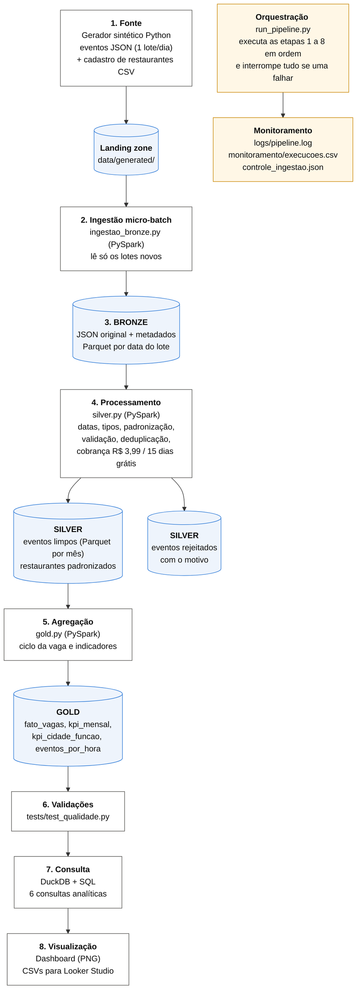

# Entrega 2: Diagrama de Arquitetura

O código-fonte do diagrama está em [`arquitetura.mmd`](arquitetura.mmd); uma versão em imagem acompanha a entrega (`arquitetura.png`).

## Fluxo dos dados

| # | Componente | Ferramenta | Entrada | Saída |
|---|---|---|---|---|
| 1 | **Fonte de dados** | Gerador Python (`ingestion/gerador_eventos.py`) | parâmetros da simulação | 1 arquivo JSON Lines por dia de operação + `restaurantes.csv` na landing zone |
| 2 | **Ingestão** (micro-batch) | PySpark (`ingestion/ingestao_bronze.py`) | lotes da landing ainda não ingeridos | camada Bronze; atualiza `controle_ingestao.json` |
| 3 | **Armazenamento bruto** | Parquet, particionado por `data_lote` | eventos como chegaram | `lake/bronze/eventos`, `lake/bronze/restaurantes` |
| 4 | **Processamento** | PySpark (`processing/silver.py`) | Bronze | `lake/silver/eventos` (particionado por `mes`), `lake/silver/restaurantes`, `lake/silver/eventos_rejeitados` |
| 5 | **Agregação** | PySpark (`processing/gold.py`) | Silver | `lake/gold/fato_vagas`, `kpi_mensal`, `kpi_cidade_funcao`, `eventos_por_hora` |
| 6 | **Validação** | DuckDB + pytest (`tests/test_qualidade.py`) | Silver e Gold | 10 verificações; falha interrompe o pipeline |
| 7 | **Consulta** | DuckDB + SQL (`queries/`) | Gold | 6 consultas analíticas em CSV |
| 8 | **Visualização** | Matplotlib (`dashboard/`) | Gold | `dashboard_umfreela.png` + CSVs para Looker Studio |
| – | **Orquestração** | Python (`orchestration/run_pipeline.py`) | – | executa 1 a 8 em ordem; se uma etapa falha, as seguintes não rodam |
| – | **Monitoramento** | logs e CSV | – | `logs/pipeline.log`, `lake/monitoramento/execucoes.csv`, `controle_ingestao.json` |

## Decisões de arquitetura

- **Medallion (Bronze, Silver, Gold):** a Bronze guarda o dado original para auditoria e reprocessamento; a Silver concentra as regras de limpeza; a Gold entrega tabelas prontas para quem analisa.
- **Parquet:** formato colunar, comprimido e com tipos, adequado para consultas analíticas (Silver e Gold), como recomendado no enunciado.
- **Micro-batch com controle de lotes:** a cada execução só os arquivos novos são lidos, o que simula a chegada contínua de dados sem reprocessar a Bronze.
- **Rejeitados em vez de apagados:** registros inválidos ficam guardados com o motivo, o que permite medir a qualidade dos dados e investigar a origem dos erros.
- **DuckDB para consultas:** lê os Parquet direto, sem servidor de banco de dados, e usa SQL padrão.
- **Sem instalação local obrigatória:** o pipeline roda no Google Colab, o que facilita a reprodução pelo professor.
